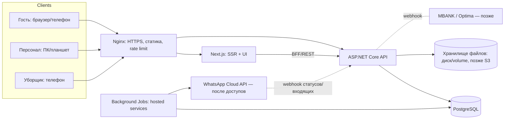

# Системная архитектура

## 1. Стиль
Модульный монолит (.NET 10, ASP.NET Core) + отдельное Next.js-приложение. Один репозиторий, один деплой backend, один PostgreSQL. Модули общаются через публичные интерфейсы (application-контракты) и доменные события, не через чужие таблицы.

## 2. Диаграмма


## 3. Модули backend
| Модуль | Ответственность | Владеет таблицами |
|---|---|---|
| Identity | пользователи, роли, права, токены | Users, Roles, Permissions, RolePermissions, UserPermissions, RefreshTokens |
| Hotel | отель, настройки, политики, настройки интеграций | Hotels, HotelSettings, IntegrationSettings |
| Rooms | номера, категории, статусы, удобства | RoomTypes, Rooms, Amenities, RoomTypeAmenities, RoomPhotos, RoomStatusHistory |
| Pricing | тарифы, скидки, услуги | RoomRates, Discounts, Services |
| Bookings | брони, доступность, цены, правила отмены | Bookings, BookingRooms, BookingGuests, BookingServices, BookingHistory |
| Guests | CRM, документы, согласия | Guests, GuestDocuments, GuestConsents |
| FrontDesk | check-in/out (оркестрация) | — (вызывает Contracts модулей Bookings, Rooms, Finance, Housekeeping в одной транзакции; чужие таблицы напрямую не трогает) |
| Housekeeping | уборка, чек-листы, заявки | HousekeepingTasks, ChecklistTemplates, ChecklistTemplateItems, HousekeepingChecklistItems, MaintenanceRequests |
| Finance | платежи, возвраты, расходы | Payments, PaymentTransactions, Refunds, Expenses, ExpenseCategories |
| PaymentGateways | адаптеры банков (`IPaymentProvider`), обработка webhook банков | — (пишет события через Platform, платежи — через Finance.Contracts) |
| Messaging | WhatsApp, email, шаблоны, автоответчик | WhatsAppMessages, NotificationTemplates |
| Reporting | KPI, отчёты, экспорт | только чтение (SQL-views/запросы) |
| Audit | аудит | AuditLogs |
| Platform | идемпотентность, jobs, файлы, outbox, приём webhook, общий DbContext | IdempotencyKeys, StoredFiles, OutboxMessages, WebhookEvents |

## 4. Слои (каждый модуль)
`Domain` (сущности, инварианты, события) → `Application` (use cases, DTO, валидаторы FluentValidation, интерфейсы) → `Infrastructure` (EF Core, адаптеры, jobs) → `Api` (контроллеры/minimal endpoints). Зависимости направлены внутрь. Ссылки между модулями — только на `*.Contracts`.

**Хранение:** один `HmsDbContext` (проект `Hms.Persistence`), одна строка подключения, одна цепочка миграций. Каждый модуль описывает свои таблицы реализацией `IModelConfigurator` (интерфейс в `Hms.Platform`, регистрируется в DI) в своём `Infrastructure` и использует свою схему PostgreSQL (`identity`, `rooms`, `bookings`, `finance` …); контекст собирает их сканированием сборок. Так операции, затрагивающие несколько модулей (check-in/out, бронь + outbox), выполняются в одной транзакции без распределённых механизмов. Изоляция модулей обеспечивается не отдельными контекстами, а правилом «только через Contracts», которое проверяют архитектурные тесты (`Hms.ArchitectureTests`, NetArchTest).

## 5. Структура репозитория
```
/
├─ CLAUDE.md
├─ README.md
├─ docs/                      (эти документы)
├─ backend/
│  ├─ Hms.sln
│  ├─ src/
│  │  ├─ Hms.Api/             (host, composition root, middleware, auth, OpenAPI)
│  │  ├─ Hms.SharedKernel/    (Result, Money, DateRange, базовые классы, события)
│  │  ├─ Hms.Platform/        (идемпотентность, jobs, storage, outbox, webhook-приём, аудит-перехватчик)
│  │  ├─ Hms.Persistence/     (HmsDbContext, миграции EF Core)
│  │  └─ Modules/
│  │     ├─ Identity/ {Domain,Application,Infrastructure,Contracts}
│  │     ├─ Hotel/  Rooms/  Pricing/  Bookings/  Guests/
│  │     ├─ FrontDesk/  Housekeeping/  Finance/
│  │     ├─ PaymentGateways/  Messaging/  Reporting/  Audit/
│  └─ tests/
│     ├─ Hms.UnitTests/
│     ├─ Hms.IntegrationTests/ (Testcontainers + PostgreSQL)
│     ├─ Hms.ApiTests/
│     └─ Hms.ArchitectureTests/ (правила зависимостей модулей)
├─ frontend/                  (Next.js, App Router)
│  └─ src/{app,components,features,lib,i18n,hooks}
│     app: (public)/ (guest)/ (staff)/admin (owner)/owner (housekeeper)/hk
├─ deploy/ {docker-compose.yml, nginx/, env.example, backup/}
└─ .github/workflows/         (CI: build, test, lint)
```

## 6. Ключевые решения
1. **Время:** `timestamptz` (UTC) для событий; `date` для CheckIn/CheckOut/служебных дат в зоне Asia/Bishkek. Конвертация в одном сервисе `IHotelClock`.
2. **Деньги:** `numeric(14,2)`, тип `Money(amount, currency='KGS')`, без `double`.
3. **Двойное бронирование:** `BookingRooms` хранит `RoomId`, `StayRange daterange [CheckIn,CheckOut)`, `IsBlocking`; в PostgreSQL `EXCLUDE USING gist (RoomId WITH =, StayRange WITH &&) WHERE (IsBlocking)` (расширение `btree_gist`). Приложение дополнительно проверяет доступность и ловит нарушение ограничения → 409 Conflict.
4. **Оптимистичная конкурентность:** `xmin`/`RowVersion` на Bookings, Payments, Rooms.
5. **Идемпотентность:** заголовок `Idempotency-Key` для POST платежей/броней/check-in/out; таблица `IdempotencyKeys` (ключ, хэш запроса, ответ, TTL).
6. **Outbox:** таблица `OutboxMessages` (модуль Platform). Сообщения WhatsApp/email и интеграционные события пишутся в той же транзакции, что и бизнес-изменение; фоновый обработчик доставляет их с ретраями обработчикам модулей (Messaging и др.). Вебхуки всех источников (банки, WhatsApp) принимаются единым конвейером Platform → `WebhookEvents` → обработчик модуля.
7. **Фоновые задачи:** `BackgroundService` + advisory lock в PostgreSQL (один исполнитель); задачи: истечение броней, NoShow, напоминания о заезде/выезде, отправка outbox, сверка платежей (P2), очистка идемпотентных ключей. Квартz/Hangfire — при росте.
8. **Аудит:** перехватчик `SaveChanges` для изменений + явные события бизнес-действий; AuditLogs append-only.
9. **Ошибки:** единый `ProblemDetails` (RFC 9457), глобальный exception handler, коды ошибок домена.
10. **Логи:** Serilog, структурированный JSON, correlation id; ПД маскируются.
11. **Файлы:** фото номеров/чеков/уборки на volume за Nginx с проверкой типа/размера; интерфейс `IFileStorage` для замены на S3.
12. **Мультиотельность:** `HotelId` во всех бизнес-таблицах, глобальный query filter; UI одного отеля.
13. **Фронтенд:** Next.js App Router, React, TypeScript, Tailwind CSS, shadcn/ui, Lucide Icons; SSR для публичных страниц, клиентские страницы для кабинетов; TanStack Query, react-hook-form + zod, i18n (next-intl) с ru по умолчанию; типы API генерируются из OpenAPI.
14. **Аутентификация и BFF:** ASP.NET Core Identity; API выдаёт JWT access (15 мин) + refresh (14 дней, ротация) и принимает только Bearer. Next.js — BFF: Server Actions вызывают API с сервера и хранят токены в httpOnly-cookie; `proxy.ts` до рендера обновляет истёкший access-токен и перенаправляет по ролям (удобство; права проверяет API); серверные компоненты читают данные через `lib/api/server.ts`. Модули обращаются к правам через `IUserAccessProvider` (Platform), реализованный модулем Identity.
15. **Email:** `IEmailSender` (SMTP). В разработке — Mailpit в docker compose; в production — SMTP заказчика (настройка в окружении).
16. **Статус номера `Reserved`:** не хранится, вычисляется при чтении (см. `database/database-design.md` §4).

## 7. Окружения и деплой
`docker compose`: `nginx`, `web` (Next.js standalone), `api`, `migrate` (одноразовое применение миграций), `db` (PostgreSQL 18), `backup` (pg_dump по расписанию + выгрузка вне сервера); в разработке дополнительно `mailpit`. TLS — Let's Encrypt (certbot). Конфигурация и секреты — переменные окружения / файлы секретов, не в git. Миграции применяются отдельной командой при релизе (не автоматически на старте в production).

## 8. Масштабирование
Начало — один VPS (2 vCPU / 4 ГБ достаточно для 30 номеров). Узкие места не ожидаются; при росте — вынос БД, S3, отдельный воркер, Redis для кэша/limits.
