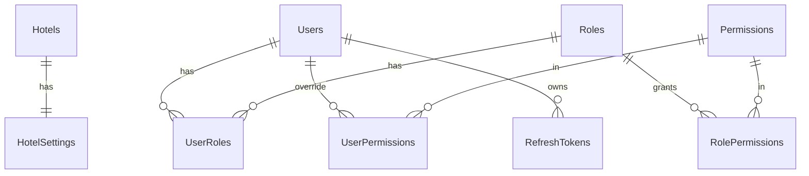
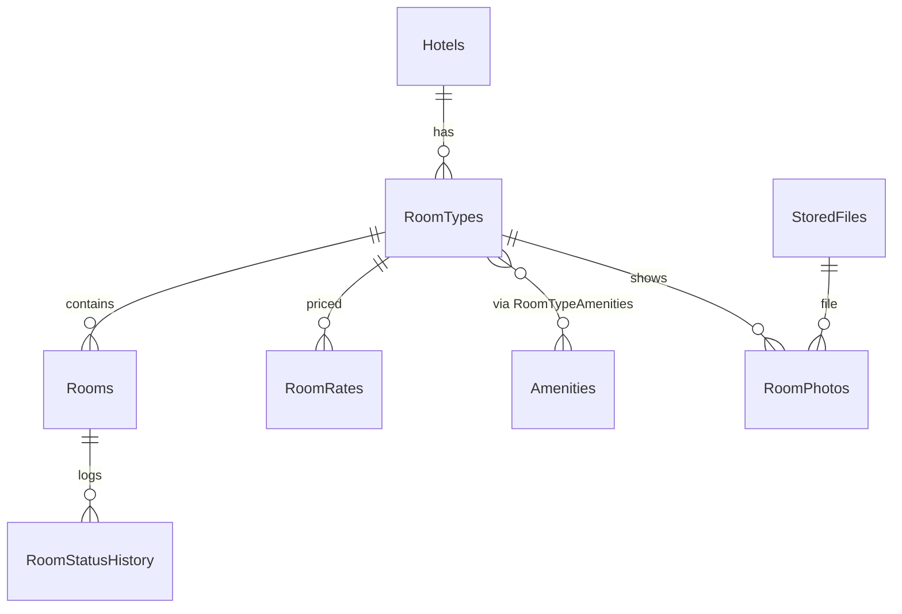
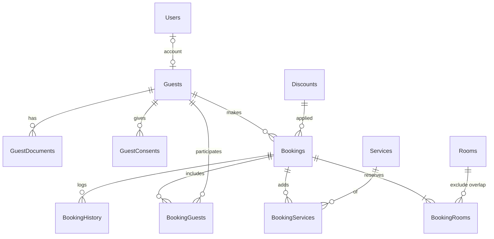
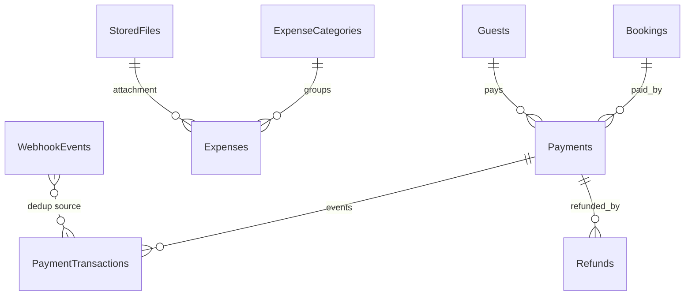
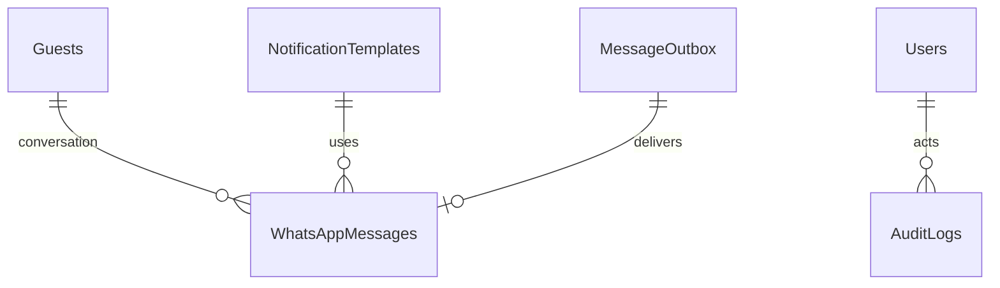

# ER-диаграмма

Диаграмма разбита по модулям для читаемости. Рендер: любой Mermaid-совместимый просмотрщик (GitHub, VS Code).

## 1. Identity и Hotel

## 2. Номера и тарифы

## 3. Гости и бронирования

## 4. Финансы

## 5. Уборка

## 6. Сообщения и платформа

## Критичные ограничения
- `BookingRooms`: `EXCLUDE USING gist (RoomId WITH =, StayRange WITH &&) WHERE (IsBlocking)`.
- `Payments`: unique `(Provider, ExternalId)`; `PaymentTransactions`: unique `(Provider, ProviderTxnId, Kind)`.
- `WebhookEvents`: unique `(Source, DedupKey)`.
- `Rooms`: unique `(HotelId, Number)`.
- `Bookings`: check `CheckOut > CheckIn`.
