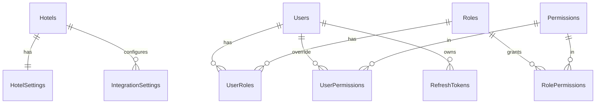
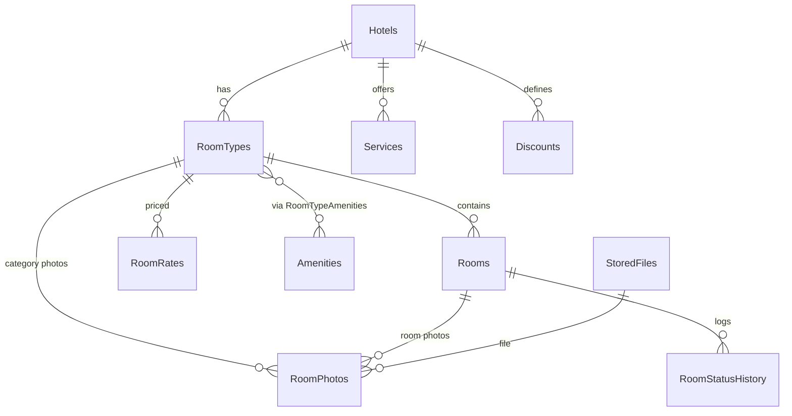
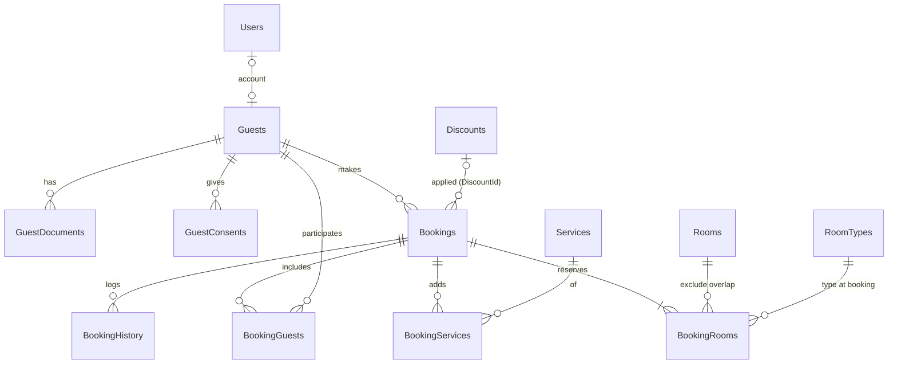
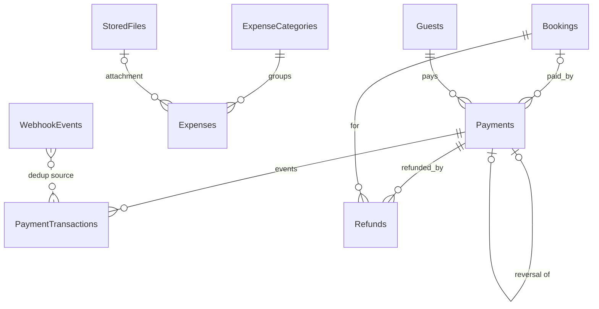
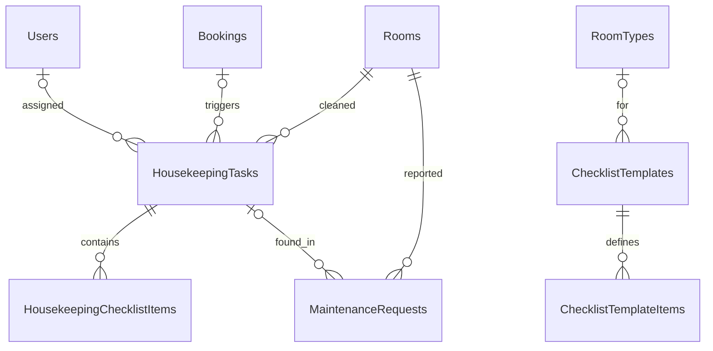
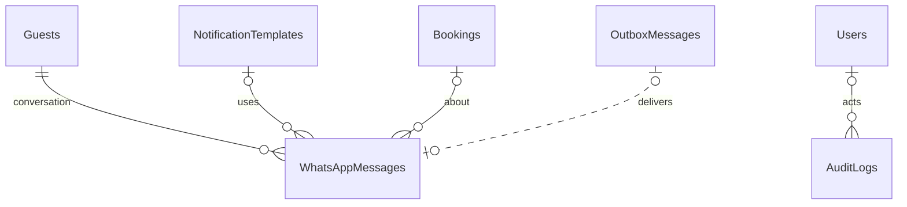

# ER-диаграмма

**Статус:** предложена архитектором, ожидает согласования заказчиком (ТЗ §14: «сначала подготовить ER-диаграмму и согласовать её»). Описание полей и обоснование отклонений от списка таблиц ТЗ: `database-design.md`.

Диаграмма разбита по модулям для читаемости. Рендер: любой Mermaid-совместимый просмотрщик (GitHub, VS Code). Во всех бизнес-таблицах есть `HotelId → Hotels` (на диаграммах не показано, кроме модуля Hotel).

## 1. Identity и Hotel

## 2. Номера и тарифы

## 3. Гости и бронирования

## 4. Финансы

## 5. Уборка

## 6. Сообщения и платформа

`OutboxMessages`, `WebhookEvents`, `IdempotencyKeys`, `StoredFiles` — технические таблицы модуля Platform; связь с бизнес-сущностями логическая (через payload/ключи), без внешних ключей.

## Критичные ограничения
- `BookingRooms`: `EXCLUDE USING gist (RoomId WITH =, StayRange WITH &&) WHERE (IsBlocking)`.
- `Bookings`: check `CheckOut > CheckIn`, `AdultsCount ≥ 1`.
- `Payments`: unique `(Provider, ExternalId)` where not null; unique `(ReversalOfPaymentId)` where not null; check `Amount > 0`.
- `PaymentTransactions`: unique `(Provider, ProviderTxnId, Kind)` where `ProviderTxnId` not null.
- `WebhookEvents`: unique `(Source, DedupKey)`.
- `OutboxMessages`: unique `DedupKey`. `IdempotencyKeys`: unique `(Scope, Key)`.
- `Rooms`: unique `(HotelId, Number)`. `IntegrationSettings`: unique `(HotelId, Provider)`.
- `RoomPhotos`: check — заполнено ровно одно из `RoomTypeId`/`RoomId`.
