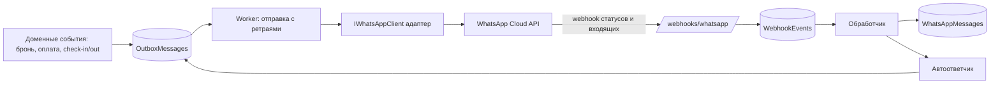

# Интеграция WhatsApp Business Platform

## 1. Статус
Заказчик предоставит номер WhatsApp Business и доступы позже. Код разрабатывается заранее через адаптер; реальные проверки — после получения доступов. Только официальный API (WhatsApp Business Platform / Cloud API от Meta). Неофициальные библиотеки и WhatsApp Web-автоматизация не используются.

**Точные параметры API (версия Graph API, форматы, лимиты, цены, категории шаблонов) нужно сверять с актуальной официальной документацией Meta на момент реализации; здесь зафиксированы архитектура и принципы, а не детали эндпоинтов.**

## 2. Принципы платформы, учитываемые в дизайне
- Инициировать диалог вне окна обслуживания можно только **утверждёнными шаблонами** (template messages); произвольный текст допустим только в окне после последнего сообщения гостя (на сегодня 24 часа — проверить в документации).
- Шаблоны проходят модерацию Meta, имеют категории (обслуживание/утилитарные/маркетинг) и язык; цены зависят от категории и страны.
- Нужно согласие (opt-in) получателя; отказ (opt-out) обязателен к соблюдению.
- Доставка асинхронна: статусы sent/delivered/read/failed приходят вебхуком.
- Webhook требует верификации (challenge) и проверки подписи запросов.
- Номер, подключённый к Cloud API, обычно нельзя одновременно использовать в обычном приложении WhatsApp на телефоне — уточнить вариант подключения (возможны режимы сосуществования) в документации Meta.

## 3. Архитектура

- `IWhatsAppClient`: `SendTemplateAsync`, `SendTextAsync` (только в окне), `GetTemplateStatusAsync`, `MarkReadAsync`.
- Отправка только через outbox; `DedupKey` = `{событие}:{сущность}:{получатель}` исключает дубли.
- Ретраи: экспоненциальная пауза для временных ошибок (сеть, 5xx, rate limit); постоянные ошибки (нет номера в WhatsApp, нет согласия, шаблон не одобрен) → `Failed` без повторов.
- Проверка перед отправкой: согласие гостя, нормализация номера (E.164, +996…), наличие одобренного шаблона на нужном языке, окно для свободного текста.
- Конфигурация: секреты (токен, App Secret, verify token) — только окружение/секрет-хранилище; несекретные параметры (phone number id, WABA id), включение и режим — экран интеграций владельца (`IntegrationSettings`).
- Outbox и приём вебхуков — общие механизмы модуля Platform (`OutboxMessages`, `WebhookEvents`); Messaging регистрирует свои обработчики.
- Тексты меню автоответчика и FAQ редактирует владелец (API `/whatsapp/auto-replies`).

## 4. Автоматические уведомления (10 по ТЗ)
| № | Событие | Триггер | Шаблон (код) | Тип |
|---|---|---|---|---|
| 1 | Подтверждение регистрации | регистрация гостя | `registration_confirmed` | утилитарный |
| 2 | Подтверждение бронирования | Booking → Confirmed | `booking_confirmed` | утилитарный |
| 3 | Успешная оплата | Payment → Paid | `payment_received` | утилитарный |
| 4 | Напоминание о заезде | job за N часов/дней до CheckIn | `checkin_reminder` | утилитарный |
| 5 | Время заселения/инструкции | вместе с №4 или отдельно | `checkin_info` | утилитарный |
| 6 | Подтверждение Check-in | check-in | `checkin_done` | утилитарный |
| 7 | Напоминание о выселении | job утром дня выезда | `checkout_reminder` | утилитарный |
| 8 | Подтверждение Check-out | check-out | `checkout_done` | утилитарный |
| 9 | Отмена | Booking → Cancelled | `booking_cancelled` | утилитарный |
| 10 | Возврат средств | Refund → Paid | `refund_info` | утилитарный |

Шаблоны создаются на русском; кыргызский и английский добавляются как языковые версии (`NotificationTemplates` по паре код+язык). Язык выбирается по предпочтению гостя.

## 5. Автоответы (входящие)
Первичный подход: детерминированное меню/ключевые слова без LLM в первой версии.
- Первое обращение → приветствие + список разделов (в окне обслуживания допустим интерактивный список/кнопки).
- Разделы: доступные номера на даты (запрос дат → ссылка на портал или расчёт), стоимость, правила, время заезда/выезда, контакты, FAQ.
- «Связаться с администратором» → создаётся задача, диалог помечается для оператора.
- Стоп-слова (STOP/«отписаться») → снимают согласие (`GuestConsents.RevokedAt`).
- Все входящие и исходящие сохраняются в `WhatsAppMessages`; ручной ответ администратора из интерфейса (вне окна — только шаблон).

## 6. Согласие
Источник opt-in фиксируется: чекбокс при регистрации/бронировании на портале, устная/письменная форма администратора с отметкой. Без согласия — только сервисные ответы на входящие сообщения гостя в окне. Юридическую формулировку согласия и классификацию «сервисное vs маркетинг» подтверждает заказчик/юрист.

## 7. Что нужно от заказчика
| Нужное | Примечание |
|---|---|
| Аккаунт Meta Business, верификация бизнеса | обычно требуется для лимитов и шаблонов |
| WhatsApp Business Account (WABA) | |
| Номер телефона (не занятый обычным WhatsApp или с планом миграции) | обсудить режим подключения |
| Phone Number ID, WABA ID | |
| Системный пользователь и постоянный токен доступа | права на сообщения и управление шаблонами |
| App Secret (для проверки подписи вебхуков) | |
| Публичный HTTPS-URL для webhook | |
| Одобрение шаблонов | мы готовим тексты, заказчик/мы подаём в Meta |
| Способ оплаты за сообщения в Meta | |

## 8. План
1. Домен сообщений, шаблоны, outbox, согласия, UI истории и ручной отправки (отправка выключена без токена).
2. Адаптер `CloudApiWhatsAppClient` по актуальной документации; тесты на проверку подписи вебхука, дедупликацию, ретраи.
3. После доступов: подача шаблонов, тест на тестовом номере, затем боевой номер.
4. Автоответчик, затем напоминания по расписанию.

## 9. Риски
Отклонение шаблонов; ограничения лимитов нового номера (тир обмена сообщениями); блокировка за жалобы; изменение политик Meta; стоимость сообщений. Меры: нейтральные утилитарные тексты, согласие, мониторинг качества номера.
