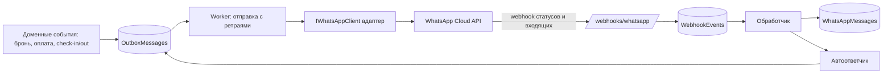

# Интеграция WhatsApp Business Platform

## 1. Статус
**Sprint 10 (2026-11-27): модуль Messaging и адаптер Cloud API готовы, отправка выключена до доступов.** Заказчик предоставит номер WhatsApp Business и доступы позже; реальные проверки (тестовый номер, модерация шаблонов) — Sprint 12. Пока WhatsApp не подключён, все уведомления уходят письмами. Только официальный API (WhatsApp Business Platform / Cloud API от Meta). Неофициальные библиотеки и WhatsApp Web-автоматизация не используются.

**Точные параметры API (версия Graph API, форматы, лимиты, цены, категории шаблонов) нужно сверять с актуальной официальной документацией Meta на момент реализации; здесь зафиксированы архитектура и принципы, а не детали эндпоинтов.**

## 2. Принципы платформы, учитываемые в дизайне
- Инициировать диалог вне окна обслуживания можно только **утверждёнными шаблонами** (template messages); произвольный текст допустим только в окне после последнего сообщения гостя (на сегодня 24 часа — проверить в документации).
- Шаблоны проходят модерацию Meta, имеют категории (обслуживание/утилитарные/маркетинг) и язык; цены зависят от категории и страны.
- Нужно согласие (opt-in) получателя; отказ (opt-out) обязателен к соблюдению.
- Доставка асинхронна: статусы sent/delivered/read/failed приходят вебхуком.
- Webhook требует верификации (challenge) и проверки подписи запросов.
- Номер, подключённый к Cloud API, обычно нельзя одновременно использовать в обычном приложении WhatsApp на телефоне — уточнить вариант подключения (возможны режимы сосуществования) в документации Meta.

## 3. Архитектура

- `IWhatsAppClient`: `SendTemplateAsync`, `SendTextAsync` (только в окне), `GetTemplateStatusAsync`, `MarkReadAsync`.
- Отправка только через outbox; `DedupKey` = `{событие}:{сущность}:{получатель}` исключает дубли.
- Ретраи: экспоненциальная пауза для временных ошибок (сеть, 5xx, rate limit); постоянные ошибки (нет номера в WhatsApp, нет согласия, шаблон не одобрен) → `Failed` без повторов.
- Проверка перед отправкой: согласие гостя, нормализация номера (E.164, +996…), наличие одобренного шаблона на нужном языке, окно для свободного текста.
- Конфигурация: секреты (токен, App Secret, verify token) — только окружение/секрет-хранилище; несекретные параметры (phone number id, WABA id), включение и режим — экран интеграций владельца (`IntegrationSettings`).
- Outbox и приём вебхуков — общие механизмы модуля Platform (`OutboxMessages`, `WebhookEvents`); Messaging регистрирует свои обработчики.
- Тексты меню автоответчика и FAQ редактирует владелец (API `/whatsapp/auto-replies`).

## 4. Автоматические уведомления (10 по ТЗ)
| № | Событие | Триггер | Шаблон (код) | Тип |
|---|---|---|---|---|
| 1 | Подтверждение регистрации | регистрация гостя | `registration_confirmed` | утилитарный |
| 2 | Подтверждение бронирования | Booking → Confirmed | `booking_confirmed` | утилитарный |
| 3 | Успешная оплата | Payment → Paid | `payment_received` | утилитарный |
| 4 | Напоминание о заезде | почасовая — за 60 мин до начала, посуточная — накануне в 18:00 (настройки) | `checkin_reminder` | утилитарный |
| 5 | Время заселения/инструкции | в тексте №2 и №4 (`{{stay_info}}`) — отдельного шаблона нет | — | — |
| 6 | Подтверждение Check-in | check-in | `checkin_done` | утилитарный |
| 7 | Напоминание о выселении | почасовая — за 15 мин до конца, посуточная — за 1 ч до выезда (настройки) | `checkout_reminder` | утилитарный |
| 8 | Подтверждение Check-out | check-out | `checkout_done` | утилитарный |
| 9 | Отмена | Booking → Cancelled | `booking_cancelled` | утилитарный |
| 10 | Возврат средств | Refund → Paid | `refund_paid` | утилитарный |
| — | Сообщение от администратора (ручная отправка вне окна 24 ч) | сотрудник | `manual_notice` | утилитарный |
| — | Код подтверждения регистрации | регистрация с подтверждением в WhatsApp | `verification_code` | аутентификация |

Шаблоны создаются на русском; кыргызский и английский добавляются как языковые версии (`NotificationTemplates` по паре код+язык). Язык выбирается по предпочтению гостя.

## 5. Автоответы (входящие)
Первичный подход: детерминированное меню/ключевые слова без LLM в первой версии.
- Первое обращение → приветствие + список разделов (в окне обслуживания допустим интерактивный список/кнопки).
- Разделы: доступные номера на даты (запрос дат → ссылка на портал или расчёт), стоимость, правила, время заезда/выезда, контакты, FAQ.
- «Связаться с администратором» → создаётся задача, диалог помечается для оператора.
- Стоп-слова (STOP/«отписаться») → снимают согласие (`GuestConsents.RevokedAt`).
- Все входящие и исходящие сохраняются в `WhatsAppMessages`; ручной ответ администратора из интерфейса (вне окна — только шаблон).

## 6. Согласие
Источник opt-in фиксируется: чекбокс при регистрации/бронировании на портале, устная/письменная форма администратора с отметкой. Без согласия — только сервисные ответы на входящие сообщения гостя в окне. Юридическую формулировку согласия и классификацию «сервисное vs маркетинг» подтверждает заказчик/юрист.

## 7. Что нужно от заказчика
| Нужное | Примечание |
|---|---|
| Аккаунт Meta Business, верификация бизнеса | обычно требуется для лимитов и шаблонов |
| WhatsApp Business Account (WABA) | |
| Номер телефона (не занятый обычным WhatsApp или с планом миграции) | обсудить режим подключения |
| Phone Number ID, WABA ID | |
| Системный пользователь и постоянный токен доступа | права на сообщения и управление шаблонами |
| App Secret (для проверки подписи вебхуков) | |
| Публичный HTTPS-URL для webhook | |
| Одобрение шаблонов | мы готовим тексты, заказчик/мы подаём в Meta |
| Способ оплаты за сообщения в Meta | |

## 8. План
1. Домен сообщений, шаблоны, outbox, согласия, UI истории и ручной отправки (отправка выключена без токена).
2. Адаптер `CloudApiWhatsAppClient` по актуальной документации; тесты на проверку подписи вебхука, дедупликацию, ретраи.
3. После доступов: подача шаблонов, тест на тестовом номере, затем боевой номер.
4. Автоответчик, затем напоминания по расписанию.

## 9. Риски
Отклонение шаблонов; ограничения лимитов нового номера (тир обмена сообщениями); блокировка за жалобы; изменение политик Meta; стоимость сообщений. Меры: нейтральные утилитарные тексты, согласие, мониторинг качества номера.

## 10. Реализация (Sprint 10, 2026-11-27)
- Модуль `Messaging` (схема `messaging`): `messages` (история, оба канала, статусы), `conversations` (диалог на номер: окно 24 ч, передача администратору), `templates` (код + язык: письмо и текст WhatsApp, имя и статус в Meta), `settings`, `auto_replies`. Приём вебхуков — `platform.webhook_events` (общий для банков).
- Уведомления: модули ставят событие (`IGuestNotifications`) в outbox в своей транзакции; Messaging выбирает канал и создаёт сообщение; отправка — отдельным outbox-сообщением по `Id` (в outbox нет текста и контактов). Канал: WhatsApp при согласии + подключённом WhatsApp + одобренном шаблоне, иначе email (решение заказчика 2026-11-27); окончательная ошибка WhatsApp → письмо-замена.
- Повторы: временные ошибки (коды 1, 2, 4, 80007, 130429, 131000, 131016, 131056, 133004, сеть, 5xx) — повтор с растущей паузой, до 8 попыток; остальные — сразу «Не отправлено». Сотрудник может повторить вручную.
- Статусы из вебхука только растут (порядок прихода не гарантирован): «доставлено» после «прочитано» не откатывает статус.
- Автоответчик: меню 1–9 (цифра или ключевые слова — побеждает пункт с наибольшим числом совпадений), приветствие на первое обращение, «не понял» + меню, пункт «Администратор» — диалог у сотрудника (автоответчик молчит до «Закрыть обращение»), «стоп» — отзыв согласия (всегда, даже при выключенном автоответчике). Ответы — свободным текстом в окне обслуживания.
- Ручная отправка: в окне — любой текст; вне окна — шаблон `manual_notice` и только при согласии гостя.
- Секреты: `Integrations__WhatsApp__AccessToken`, `__AppSecret`, `__VerifyToken` (deploy/.env: `WHATSAPP_*`). Версия Graph API — `Integrations:WhatsApp:GraphApiVersion` (v27.0).
- Адрес вебхука для Meta: `https://<домен>/api/v1/webhooks/whatsapp`. В production Nginx должен пропускать к API только `/api/v1/webhooks/` (остальной API закрыт, браузер ходит через Next.js) — Sprint 11.
- Тесты: fake-клиент только в тестовом проекте (`tests/Hms.IntegrationTests/Messaging/FakeWhatsAppClient.cs`).

### Сверено с документацией Meta (2026-11-27)
Messages reference (POST `/{version}/{phone-number-id}/messages`, Bearer), template fundamentals (`template.name`, `language.code`, `components[type=body].parameters`, именованные параметры `parameter_name` при `parameter_format: named`), authentication templates (код дважды: в тексте и в кнопке `sub_type: url`, `index: "0"`; текст шаблона задаёт Meta), webhooks (`hub.*`, `X-Hub-Signature-256: sha256=…`, payload `entry[].changes[].value.messages|statuses|contacts|metadata`), error codes, окно обслуживания 24 ч, номер получателя — E.164 с «+», язык `ru`.

### Проверить при подключении (Sprint 12)
1. Проверка соединения — `GET /{version}/{phone-number-id}` (сведения о номере): на странице не сверялась, проверить на реальном токене.
2. Шаблоны в WhatsApp Manager создать с `parameter_format: named` и теми же именами переменных, что в системе (`{{guest_name}}`, …); для кода — категория «Аутентификация» с кнопкой «Скопировать код».
3. Пользователи с именем пользователя (BSUID): входящие без номера `from` сейчас пропускаются — решить, нужна ли поддержка.
4. Совпадение `language.code` при отправке с языком шаблона в Meta (документация явно не утверждает).
5. Режим сосуществования номера с приложением WhatsApp Business на телефоне.
